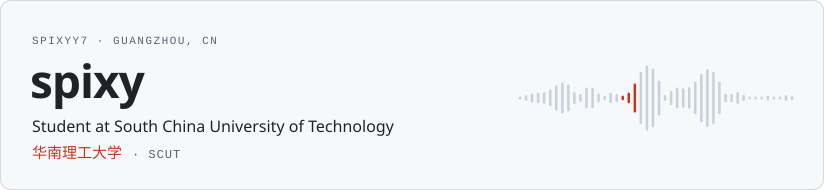
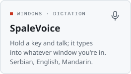
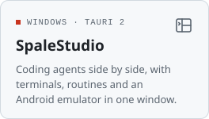
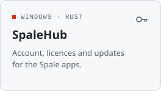
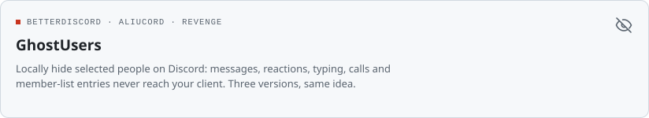
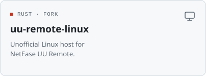
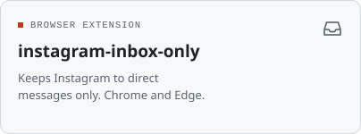
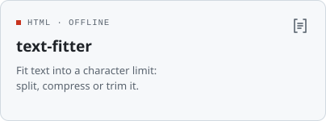
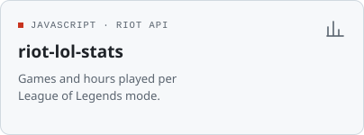

<picture><source media="(prefers-color-scheme: dark)" srcset="assets/header-dark.svg"></picture>

I build small desktop and Android tools, mostly in Rust, TypeScript and Kotlin. Most of it is for Windows, and most of it started because I needed it myself.

#### Spale apps

<picture><source media="(prefers-color-scheme: dark)" srcset="assets/spalevoice-dark.svg"></picture>
<picture><source media="(prefers-color-scheme: dark)" srcset="assets/spalestudio-dark.svg"></picture>
<picture><source media="(prefers-color-scheme: dark)" srcset="assets/spalehub-dark.svg"></picture>

#### Other projects

<a href="https://github.com/spixyy7/bd-ghostusers"><picture><source media="(prefers-color-scheme: dark)" srcset="assets/ghostusers-dark.svg"></picture></a>

<a href="https://github.com/spixyy7/uu-remote-linux"><picture><source media="(prefers-color-scheme: dark)" srcset="assets/uu-remote-dark.svg"></picture></a>
<a href="https://github.com/spixyy7/instagram-inbox-only"><picture><source media="(prefers-color-scheme: dark)" srcset="assets/ig-inbox-dark.svg"></picture></a>
<a href="https://github.com/spixyy7/text-fitter"><picture><source media="(prefers-color-scheme: dark)" srcset="assets/text-fitter-dark.svg"></picture></a>
<a href="https://github.com/spixyy7/riot-lol-stats"><picture><source media="(prefers-color-scheme: dark)" srcset="assets/lol-stats-dark.svg"></picture></a>

GhostUsers: <a href="https://github.com/spixyy7/bd-ghostusers">BetterDiscord</a> · <a href="https://github.com/spixyy7/ghostusers-aliucord">Aliucord</a> · <a href="https://github.com/spixyy7/ghostusers-revenge">Revenge</a>

<picture><source media="(prefers-color-scheme: dark)" srcset="assets/stack-dark.svg"></picture>
